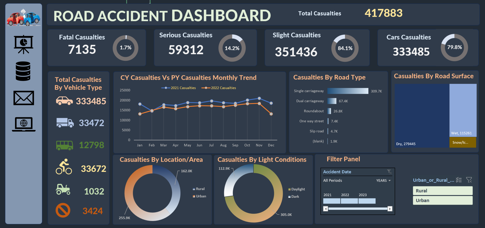

# 🚗 Road Accident Data Analysis

Excel project analyzing road accident data to identify patterns by severity, time, road conditions, weather, and location.


## 1. Project Purpose
- Analyze road accident data.
- Identify patterns by severity, time, road conditions, and location.
- Present findings through an Excel dashboard.

## 2. Key Insights and Results
- **307,973** recorded rows across 23 columns.
- **85.5%** of records involved slight-severity accidents.
- November had the highest monthly count.
- **5 PM** had the highest hourly count.
- Single carriageways represented **74.9%** of records.
- Urban areas accounted for **64.5%** of records.
- Cars represented **77.9%** of recorded vehicle types.

## 3. Tools and Technical Skills
- Microsoft Excel
- PivotTables and formulas
- Data cleaning and quality checks
- Exploratory data analysis (EDA)
- Data visualization and dashboard design

## 4. Methodology and Data Cleaning
- Inspected dataset structure and columns.
- Checked missing values and data consistency.
- Summarized records by time, severity, road type, weather, and location.
- Compared category counts to identify key patterns.
- Reviewed duplicate identifiers and data-quality limitations.

## 5. Dashboard Screenshots or Visuals



## 6. Repository Structure and Instructions

```text
Road-Accident-Analysis/
├── Data Analysis and Dashboard/
│   └── Road Accident Data Analysis.xlsx
├── Data Sheet/
│   └── Road Accident Data.xlsx
├── Images/
│   ├── Dashboard.png
│   └── road-accident-dashboard.png
└── README.md
```

- Clone or download the repository.
- Open the Excel workbook.
- Explore the analysis and dashboard visuals.

**Note:** Recorded rows may not represent unique accidents. Counts alone do not establish accident causes or risk levels.
